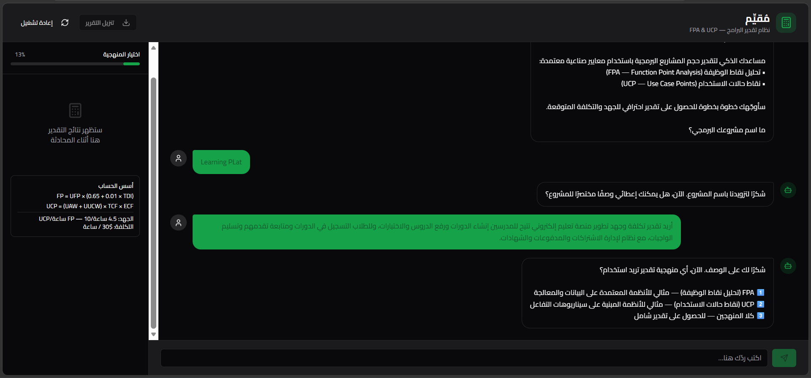

# Software Effort Estimator — مُقيِّم

An Arabic, right-to-left conversational assistant for estimating software project size, effort, and cost with Function Point Analysis (FPA), Use Case Points (UCP), or both.

## Features

- Guides users through a software estimation conversation in Arabic.
- Collects FPA inputs: ILF, EIF, EI, EO, EQ, and the 14 General System Characteristics (GSCs).
- Collects UCP inputs: actors, use cases, 13 Technical Complexity Factors (TCF), and 8 Environmental Complexity Factors (ECF).
- Shows calculated metrics as the conversation progresses.
- Provides a print-ready Arabic report that can be saved as a PDF from the browser.
- Supports starting a fresh estimation session.

The current estimate assumptions are **4.5 person-hours per Function Point**, **10 person-hours per Use Case Point**, and **$30 per hour**.

## Tech stack

- **Frontend:** React 18, Vite, Tailwind CSS, shadcn/ui
- **Backend:** Node.js, Express
- **AI:** OpenAI-compatible API, with support for Groq and OpenAI integrations

## Project structure

```text
apps/
├── api/
│   └── src/
│       ├── estimation/    # FPA/UCP calculations and AI conversation logic
│       ├── routes/        # Estimation API routes
│       └── server.js
└── web/
    └── src/
        ├── pages/         # Estimation interface
        └── components/    # Shared UI components
```

## Run locally

### Requirements

- Node.js 20.19+ (or 22.12+)
- npm
- An API key for Groq or OpenAI to use the AI chat

### Install

Clone the repository and install dependencies from its root:

```bash
git clone https://github.com/karamlk/software-effort-estimator.git
cd software-effort-estimator
npm install
```

Create `apps/api/.env` and add **one** AI provider key:

```env
GROQ_API_KEY=your_groq_api_key
```

Alternatively, use an OpenAI key:

```env
OPENAI_API_KEY=your_openai_api_key
```

Keep `.env` files and API keys out of GitHub. Never commit real credentials.

### Start the app

From the repository root, run:

```bash
npm run dev
```

Open [http://localhost:5000/estimation](http://localhost:5000/estimation). The Vite frontend runs on port `5000` and proxies API requests to the Express server on port `3001`.

## Available scripts

| Command | Description |
|---------|-------------|
| `npm run dev` | Start the API and web development servers |
| `npm run dev:api` | Start the API server only |
| `npm run dev:web` | Start the web development server only |
| `npm run build` | Build the web app |
| `npm run lint` | Run the web app linter |

## API

| Method | Endpoint | Description |
|--------|----------|-------------|
| `GET` | `/api/health` | API health check |
| `POST` | `/api/estimation/chat` | Send a message in an estimation session |
| `POST` | `/api/estimation/reset` | Reset an estimation session |

## Session and data notes

- Estimation conversations are held in API server memory; they are not saved to a database and are cleared when the API server restarts.
- The browser stores the current session ID in `sessionStorage`.
- Messages are sent to the AI provider configured for the server so it can generate replies.
- Estimates are planning aids, not guarantees; actual project effort and cost depend on the project and the assumptions used.

## Screenshots

### Chat Interface
